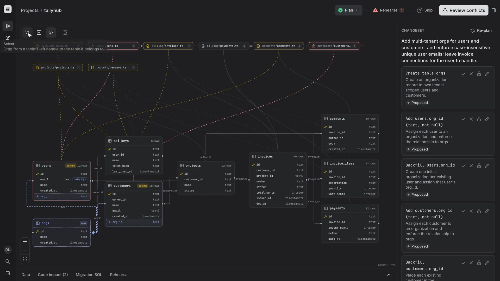
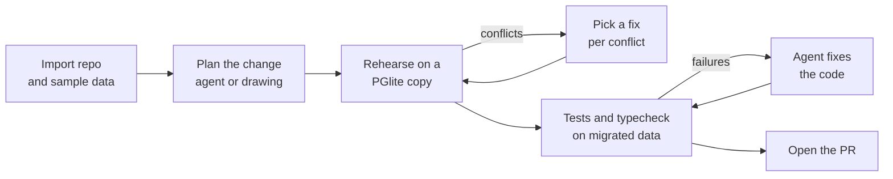
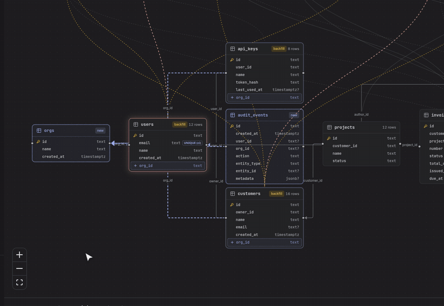
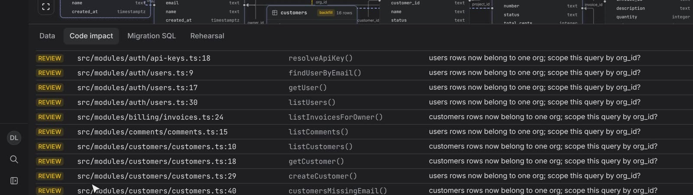
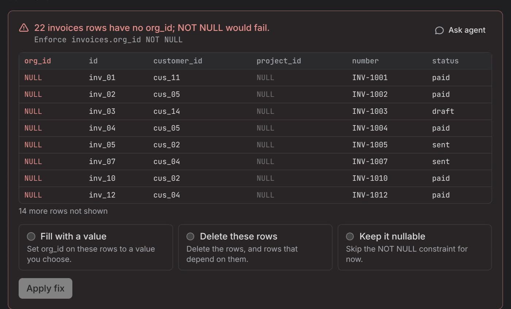
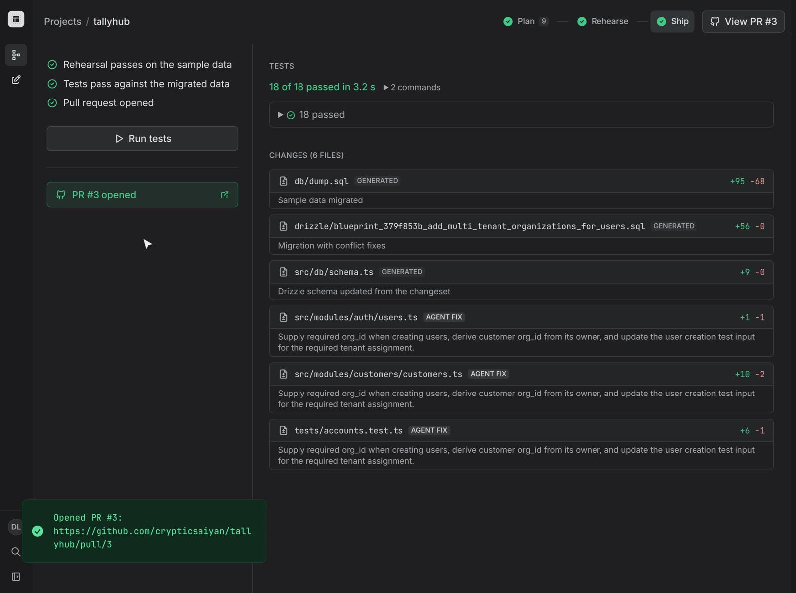
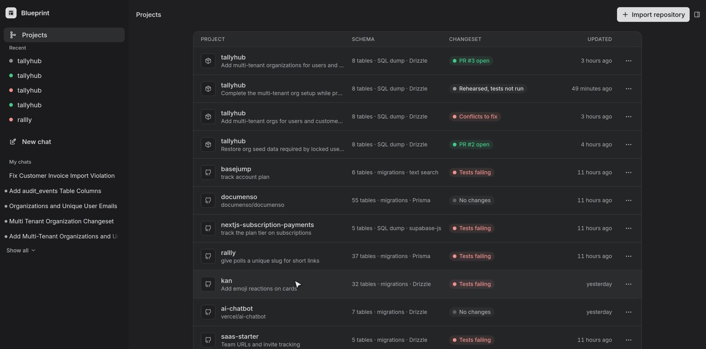

<div align="center">


# Blueprint

**See, rehearse, and ship Postgres schema changes before production finds out.**

An agent-native workspace that maps your schema and code, runs the real migration on a copy of your data, fixes the code that breaks, and opens a pull request that already passes your tests.

[](https://agent-native.com)


[Slides](docs/blueprint-slides.pdf) · [Real pull request from the demo](https://github.com/crypticsaiyan/tallyhub/pull/3) · [Quick start](#quick-start)

<br />



</div>

## Why Blueprint

Schema changes are the riskiest deploys a team makes.

- **You can't see what a migration will break.** Review shows SQL, not the queries and rows it affects.
- **Real data is messy.** Duplicates, nulls, and orphaned rows trip constraints that passed every test.
- **Code breaks quietly.** A new required column breaks inserts in modules nobody thought to check.
- **You find out in production.**

Blueprint moves all of that before the merge: you see the impact, rehearse on real data, and ship a pull request whose code and tests already work.

## How it works



### 1. See the impact

Import a repo and Blueprint builds **one map** of every table (with row counts from the sample data) and the code modules above it, with lines for which module reads or writes each table.

- **Ask the agent** for a change in plain English, like "add multi-tenant orgs". It proposes a changeset of ghost tables and columns, drawn dashed on the map, each with a reason.
- **Or draw it.** Drag a line between two tables to get the column, the backfill, and the foreign key, plus a count of the rows the backfill can fill. Sketch a new table and the agent fills in its columns.
- **Steer it.** Accept, reject, lock, or edit each change. Re-plan, and the agent works around your locked decisions.
- **Inspect anything.** Click a table for its columns, planned changes, queries, and real rows. Click a module for its queries, line by line.
- **Code impact** lists every query the change affects, with file and line.
- **Architecture rules** forbid an import between two modules; the agent can fix the violation.

<p align="center"></p>

<p align="center"></p>

### 2. Rehearse on real data

Blueprint runs the generated migration on a [PGlite](https://pglite.dev) copy of your data. Each step is listed with its timing, and every changed row is highlighted, before and after.

**Conflicts** show the exact rows that would fail in production: duplicates blocking a unique index, nulls breaking `NOT NULL`, orphans breaking a foreign key. Pick a fix for each (merge or rename duplicates, delete or null out rows, fill a value, or keep the column nullable), and the rehearsal runs again until it passes.

<p align="center"></p>

### 3. Ship a pull request that works

- **The migration is generated:** new columns added nullable, backfills run parents first, constraints enforced last, in one transaction. Drizzle and Prisma schemas and Supabase `Database` types are regenerated to match.
- **Your tests run on the migrated data.** The repo's own test suite and typecheck run in a working copy. When something fails, the agent fixes the queries with small edits you can review.
- **Every changed file is labeled:** generated by Blueprint, fixed by the agent, or edited by you.
- **One click opens the pull request** with the migration, backfill, schema, and code fixes. [Here is a real one.](https://github.com/crypticsaiyan/tallyhub/pull/3)

<p align="center"></p>

## Agent-native

Every button in Blueprint is an [Agent-Native](https://agent-native.com) action the agent can call too. Click it, or ask for it in chat: you and the agent always work on the same plan.

| Area | Actions |
|---|---|
| Import and read | `import-repo`, `get-project-map`, `list-projects`, `delete-project` |
| Plan and steer | `propose-changeset`, `update-change-item`, `replan-changeset` |
| Draw | `draw-table`, `draw-relationship`, `delete-relationship`, `arrange-map` |
| Rehearse | `rehearse-migration`, `resolve-conflict` |
| Fix code and test | `find-code-impact`, `read-code-file`, `fix-queries`, `run-tests`, `cancel-tests` |
| Rules | `add-rule`, `delete-rule` |
| Ship | `get-ship-status`, `create-pr` |

## Works on real repos

Blueprint reads the schema from Postgres itself (a SQL dump, or the repo's migrations replayed in PGlite), so it is not tied to one ORM. It understands queries written with:

- **Drizzle**, including `pgTableCreator` and `pgSchema`
- **Prisma**, including relations
- **supabase-js**, including other schemas via `.schema()`
- **Plain SQL**, with text search as a fallback

It has been run on open source apps including Documenso, Rallly, Kan, Basejump, Vercel's AI Chatbot and Next.js Subscription Payments, and the Next.js SaaS Starter. Tables outside `public` appear as `schema.table`, and extensions such as pgvector load in the sandbox.

<p align="center"></p>

## Quick start

Requirements: Node 22.22+ and pnpm 10.

```bash
git clone https://github.com/crypticsaiyan/blueprint.git
cd blueprint
pnpm install
pnpm dev
```

Open <http://localhost:8080>, choose **Continue as local dev**, then **Import repository → Use the demo repo**. Ask the agent to "add multi-tenant orgs" and follow the steps across the top: Plan, Rehearse, Ship.

| Setting | Where | Needed for |
|---|---|---|
| Agent model | The model picker in the agent panel | Chatting with the agent |
| `GITHUB_TOKEN` | Settings → Secrets | Opening pull requests |

To import your own project, paste its GitHub URL and, optionally, the path to a SQL dump or migrations folder.

> **Note:** importing a repo and running its tests executes that repo's code on the machine running Blueprint. Only import repos you trust.

## The demo repo

[`demo-repo/`](demo-repo) is **Tallyhub**, a small invoicing app made for this project: 8 tables, Drizzle queries in six modules, a Vitest suite, and deliberately messy seed data (duplicate emails, missing emails, orphaned invoices) so the rehearsal has real conflicts to find.

## Architecture

```text
actions/                    one file per action, shared by the UI and the agent
app/routes/                 projects dashboard, map, rehearse, ship
app/components/blueprint/   map canvas, inspector, rehearsal and ship views
server/lib/                 import, introspection, PGlite sandbox, rehearsal,
                            test runner, working copies, pull requests
server/lib/code/            code analysis and codegen: Drizzle, Prisma,
                            supabase-js, Supabase types
shared/changes.ts           changeset model: validation, projection, migration compiler
demo-repo/                  Tallyhub, the demo app
scripts/demo-edit/          records and edits the demo video
```

- **Schema** comes from Postgres catalogs, never from ORM files.
- **Changesets** are lists of typed items (`create_table`, `add_column`, `backfill`, `add_foreign_key`, and so on). The compiler orders them into a safe migration: add nullable, backfill parents first, then enforce.
- **Rehearsals** load the dump into PGlite, apply the migration step by step, and diff every table.
- **Code fixes** land in a per-changeset working copy of the repo; tests run there against the migrated data, and the pull request is pushed from it.

## Development

```bash
pnpm test                    # unit tests (Vitest)
pnpm typecheck               # TypeScript
pnpm agent-native:doctor     # framework guardrails
```

The demo video was recorded with [`scripts/demo-edit/`](scripts/demo-edit): it drives the real app in Chrome on a virtual 4K monitor, logs where each action happens, and edits the takes into the final cut with an AssemblyAI voiceover. Everything in the video is the app really running.

## Built with

[Agent-Native](https://agent-native.com) · [PGlite](https://pglite.dev) and pgvector · [React Flow](https://reactflow.dev) · [ts-morph](https://ts-morph.com) · [Drizzle ORM](https://orm.drizzle.team) · [Octokit](https://github.com/octokit/octokit.js) · React Router · TanStack Query · Tabler Icons · Inter

## Hackathon disclosure

Built for the Builder.io Agent-Native Hackathon by Rahul Joshi.

Blueprint started from the Agent-Native **Chat** template (commit `c317c6c`), which provides the app shell, auth, the agent sidebar, and the UI components. Everything specific to Blueprint was built during the hackathon, starting 2026-11-08: the actions, the map, the changeset model, the PGlite rehearsal, code analysis and codegen, the test runner, the pull request flow, and the Tallyhub demo repo.
